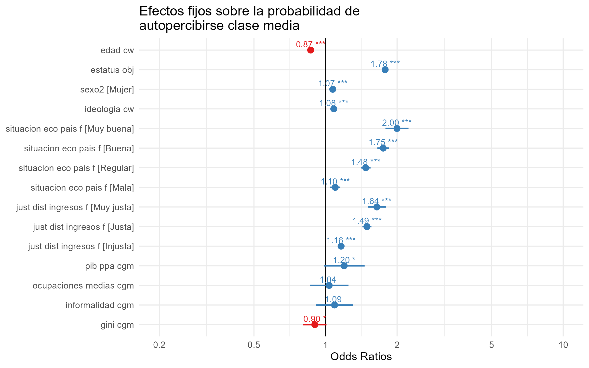

```{r Carga librerías y bases, include=FALSE}
rm(list = ls())

pacman::p_load(tidyverse, Hmisc, gtsummary, GDAtools, jtools, huxtable, survey, ggoxford, ggtext, lme4, performance, sjPlot, ggsci, flextable)

theme_set(theme_light())

load("bases/latinobarometro_select.RData")
load("bases/base_datos_agregados.RData")
enrs <- haven::read_sav("bases/Base de datos ENRS PISAC.sav")

#id único
latinobarometro <- latinobarometro %>%
  group_by(pais, anio) %>%
  mutate(id_fila = paste0(pais, anio, row_number())) %>%
  ungroup()


#Banderas
latinobarometro <- latinobarometro  %>%  
  mutate(iso3 = countrycode::countrycode(pais,
                                         origin = "iso3n",
                                         destination = "iso3c"))

#Unión bases individual y agregada
latinobarometro <- latinobarometro %>% 
  left_join(datos_paises, by = c("anio", "iso3")) 

latinobarometro <- latinobarometro %>% 
  mutate(anio_pais = interaction(iso3, anio))

latinobarometro_sel <- latinobarometro %>% 
  filter(anio %in% c(2011, 2013, 2015, 2017, 2018, 2020, 2023, 2024), !iso3 %in% c("ESP", "VEN", "NIC"))

rm(latinobarometro, datos_paises)
```


```{r Construcción estatus objetivo, include=FALSE}
latinobarometro_sel <- latinobarometro_sel %>% 
  mutate(trabajo_f = case_when(
    estado_ocupacional_f %in% c("Temporalmente no trabaja", "Retirado/pensionado") ~ trabajo_anterior_f, 
                               estado_ocupacional_f %in% c("No trabaja", "Estudiante") ~ "No trabaja",
         TRUE ~ trabajo_actual_f))

# Construcción de variables para el MCA ----------------


#2011
var_obj_2011 <- latinobarometro_sel %>%
  filter(anio == 2011) %>%
  select(trabajo_f, nivel_ed, bienes_lava, bienes_celular, bienes_auto, bienes_cloaca,
         bienes_aguacal, bienes_casa, wt, id_fila)

mca2011 <- speMCA(var_obj_2011[,1:8], ncp = 2, row.w = var_obj_2011$wt)

modif.rate(mca2011)$modif

mca2011 <- flip.mca(mca2011, dim = 1)

ggcloud_variables(mca2011, vlab = T, shapes = T, shapesize = 1.5, force = 2,
                  textsize = 2.3, ) + 
  labs(title = "MCA 2011")

#2013
var_obj_2013 <- latinobarometro_sel %>%
  filter(anio == 2013) %>%
  select(trabajo_f, nivel_ed, bienes_lava, bienes_celular, bienes_auto, bienes_cloaca,
         bienes_aguacal, bienes_casa, wt, id_fila)

mca2013 <- speMCA(var_obj_2013[,1:8], ncp = 2, row.w = var_obj_2013$wt)

modif.rate(mca2013)$modif

mca2013 <- flip.mca(mca2013, dim = 1)

ggcloud_variables(mca2013, vlab = T, shapes = T, shapesize = 1.5, force = 2,
                  textsize = 2.3) + 
  labs(title = "MCA 2013")

#2015
var_obj_2015 <- latinobarometro_sel %>%
  filter(anio == 2015) %>%
  select(trabajo_f, nivel_ed, bienes_lava, bienes_celular, bienes_auto, bienes_cloaca,
         bienes_aguacal, bienes_casa, wt, id_fila)

mca2015 <- speMCA(var_obj_2015[,1:8], ncp = 2, row.w = var_obj_2015$wt)

modif.rate(mca2015)$modif

mca2015 <- flip.mca(mca2015, dim = 1)

ggcloud_variables(mca2015, vlab = T, shapes = T, shapesize = 1.5, force = 2,
                  textsize = 2.3) +
  labs(title = "MCA 2015")

#2017
var_obj_2017 <- latinobarometro_sel %>%
  filter(anio == 2017) %>%
  select(trabajo_f, nivel_ed, bienes_lava, bienes_celular, bienes_auto, bienes_cloaca,
         bienes_aguacal, bienes_casa, wt, id_fila)

mca2017 <- speMCA(var_obj_2017[,1:8], ncp = 2, row.w = var_obj_2017$wt)

modif.rate(mca2017)$modif

mca2017 <- flip.mca(mca2017, dim = 1)

ggcloud_variables(mca2017, vlab = T, shapes = T, shapesize = 1.5, force = 2,
                  textsize = 2.3) + 
  labs(title = "MCA 2017")

#2018
var_obj_2018 <- latinobarometro_sel %>%
  filter(anio == 2018) %>%
  select(trabajo_f, nivel_ed, bienes_lava, bienes_celular, bienes_auto, bienes_cloaca,
         bienes_aguacal, bienes_casa, wt, id_fila)

mca2018 <- speMCA(var_obj_2018[,1:8], ncp = 2, row.w = var_obj_2018$wt)

modif.rate(mca2018)$modif

mca2018 <- flip.mca(mca2018, dim = 1)

ggcloud_variables(mca2018, vlab = T, shapes = T, shapesize = 1.5, force = 2,
                  textsize = 2.3) + 
  labs(title = "MCA 2018")


#2020
var_obj_2020 <- latinobarometro_sel %>%
  filter(anio == 2020) %>%
  select(trabajo_f, nivel_ed, bienes_lava, bienes_celular, bienes_auto, bienes_cloaca,
         bienes_aguacal, bienes_casa, wt, id_fila)

mca2020 <- speMCA(var_obj_2020[,1:8], ncp = 2, row.w = var_obj_2020$wt)

modif.rate(mca2020)$modif

mca2020 <- flip.mca(mca2020, dim = 1)

ggcloud_variables(mca2020, vlab = T, shapes = T, shapesize = 1.5, force = 2,
                  textsize = 2.3) + 
  labs(title = "MCA 2020")

#2023
var_obj_2023 <- latinobarometro_sel %>%
  filter(anio == 2023) %>%
  select(trabajo_f, nivel_ed, bienes_lava, bienes_celular, bienes_auto, bienes_cloaca,
         bienes_aguacal, bienes_casa, wt, id_fila)

mca2023 <- speMCA(var_obj_2023[,1:8], ncp = 2, row.w = var_obj_2023$wt)

modif.rate(mca2023)$modif

mca2023 <- flip.mca(mca2023, dim = 1)

ggcloud_variables(mca2023, vlab = T, shapes = T, shapesize = 1.5, force = 2,
                  textsize = 2.3) + 
  labs(title = "MCA 2023")

#2024
var_obj_2024 <- latinobarometro_sel %>%
  filter(anio == 2024) %>%
  select(trabajo_f, nivel_ed, bienes_lava, bienes_celular, bienes_auto, bienes_cloaca,
         bienes_aguacal, bienes_casa, wt, id_fila)

mca2024 <- speMCA(var_obj_2024[,1:8], ncp = 2, row.w = var_obj_2024$wt)

modif.rate(mca2024)$modif

mca2024 <- flip.mca(mca2024, dim = 1)

ggcloud_variables(mca2024, vlab = T, shapes = T, shapesize = 1.5, force = 2,
                  textsize = 2.3) + 
  labs(title = "MCA 2024")


#Pego los puntajes factoriales
coords <- bind_rows(
  data.frame(anio = 2011, id_fila = var_obj_2011$id_fila, dim1 = mca2011$ind$coord[, 1]),
  data.frame(anio = 2013, id_fila = var_obj_2013$id_fila, dim1 = mca2013$ind$coord[, 1]),
  data.frame(anio = 2015, id_fila = var_obj_2015$id_fila, dim1 = mca2015$ind$coord[, 1]),
  data.frame(anio = 2017, id_fila = var_obj_2017$id_fila, dim1 = mca2017$ind$coord[, 1]),
  data.frame(anio = 2018, id_fila = var_obj_2018$id_fila, dim1 = mca2018$ind$coord[, 1]),
  data.frame(anio = 2020, id_fila = var_obj_2020$id_fila, dim1 = mca2020$ind$coord[, 1]),
  data.frame(anio = 2023, id_fila = var_obj_2023$id_fila, dim1 = mca2023$ind$coord[, 1]),
  data.frame(anio = 2024, id_fila = var_obj_2024$id_fila, dim1 = mca2024$ind$coord[, 1])
)

estandarizar_ponderado <- function(x, w) {
  media_ponderada <- sum(x * w) / sum(w)
  var_ponderada <- sum(w * (x - media_ponderada)^2) / sum(w)
  desv_ponderada <- sqrt(var_ponderada)
  return((x - media_ponderada) / desv_ponderada)
}

latinobarometro_sel <- latinobarometro_sel %>%
  left_join(coords, by = c("anio", "id_fila")) %>% 
  mutate(dim1_std = estandarizar_ponderado(dim1, wt),
         dim1_01= scales::rescale(dim1, to = c(0, 1)))


rm(coords, var_obj_2011, var_obj_2013, var_obj_2015, var_obj_2017, var_obj_2018, var_obj_2020, var_obj_2023, var_obj_2024,
   mca2011, mca2013, mca2015, mca2017, mca2018, mca2020, mca2023, mca2024)

```

```{r Arreglo de variables, include=FALSE}
#centrar y escalar variables
latinobarometro_sel <- latinobarometro_sel %>% 
  group_by(anio_pais) %>% 
  mutate(edad_cw = scale(edad, center = T, scale = T),
         estatus_obj = scale(dim1_std, center = T),
         estatus_01 = scales::rescale(dim1_std, to = c(0, 1)),
         ideologia_cw = scale(ideologia, center = T, scale = T)) %>% 
  ungroup() %>% 
  mutate(
    clase_media = factor(case_when(clase_subjetiva_f %in% c("Alta", "Media alta",
                                                            "Media") ~ 1,
                                   TRUE ~ 0)),
    clase_media2 = factor(case_when(clase_subjetiva_f %in% c("Alta", "Media alta") ~ 1,
                                   TRUE ~ 0)),
    clase_media3 = factor(case_when(clase_subjetiva_f %in% c("Media") ~ 1,
                                   TRUE ~ 0)),
    pib_ppa_cgm = scale(pib_ppa,center = T, scale = T),
    gini_cgm = scale(gini, center = T, scale = T),
    informalidad_cgm = scale(informalidad, center = T, scale = T),
    ocupaciones_medias_cgm = scale(ocupaciones_medias, center = T, scale = T),
    ocupaciones_profesionales_cgm = scale(ocupaciones_profesionales, center = T, scale = T),
    empleo_cgm = scale(emp_publico, center = T, scale = T),
    palma_cgm = scale(palma, center = T, scale = T),
    pib_log = log10(pib_ppa),
    cuentapropia_cgm = scale(cuentapropia, center = T, scale = T))

```


```{r Variables ENRS, include=FALSE}
enrs <- enrs %>%
  mutate(
    across(c(P10k1, P10k2, P10k3, P10k4, P10k5),
           ~ case_when(
             . == 1 ~ 0,
             . == 2 ~ -1,
             . == 3 ~ 1,
             TRUE ~ NA_real_
           )),
    n_validos = rowSums(!is.na(across(c(P10k1, P10k2, P10k3)))),
    indice_pos_rel = if_else(
      n_validos > 0,
      rowSums(across(c(P10k1, P10k2, P10k3)), na.rm = TRUE) / n_validos,
      NA_real_
    ),
    ocupacion = haven::as_factor(P50e, levels = "labels"),
    ingresos = haven::as_factor(P51, levels = "labels"),
    posicion_amigo1 = as.factor(case_when(
      P10k1 == 0 ~ "Igual posición",
      P10k1 == -1 ~ "Alter posición más alta",
      P10k1 == 1 ~ "Alter posición más baja",
      TRUE ~ NA_character_
    )),
    clase = case_when(
      ocupacion %in% c("Directivo/a, gerente/a o propietario/a de empresas (no comerciante)", "Profesional") ~ "Clase directivo - profesional",
      ocupacion == "Técnico" & P50a == 3 ~ "Clase media rutinaria",
      ocupacion == "Administrativo/a u oficinista" ~ "Clase media rutinaria",
      ocupacion %in% c("Técnico", "Comerciante y trabajadores/as calificados/as del comercio y ventas", "Trabajador/a calificado/a de servicios") & P50a != 3 ~ "Pequeña burguesía",
      ocupacion %in% c("Trabajador/a calificado/a de la construcción, industria y transporte", "Comerciante y trabajadores/as calificados/as del comercio y ventas", "Trabajador/a calificado/a de servicios") ~ "Clase obrera calificada",
      ocupacion %in% c("Trabajador/a no calificado/a de la construcción, industria y transporte", "Trabajadores/as no profesionales de la agricultura, ganadería y pesca", "Servicio doméstico en hogares particulares",
                       "Trabajador/a no calificado/a de comercio y servicios") ~ "Clase obrera no calificada",
      TRUE ~ NA_character_
    ),
    clase = factor(clase, levels = c("Clase directivo - profesional", "Clase media rutinaria", "Pequeña burguesía", "Clase obrera calificada", "Clase obrera no calificada")),
    lugar_conocimiento1 = case_when(P10g1 == 1 ~ "Familiar",
                                    P10g1 == 2 ~ "Escuela, universidad",
                                    P10g1 == 3 ~ "Trabajo",
                                    P10g1 == 6 ~ "Barrio",
                                    P10g1 %in% c(4, 5, 7, 8 ,9) ~ "Otros",
                                    TRUE ~ NA_character_
                                    ),
    lugar_conocimiento1 = factor(lugar_conocimiento1, levels = c("Familiar", "Escuela, universidad", "Trabajo", "Barrio", "Otros")),
    amigos_otra_posicion = case_when(P28_3 == 1 ~ "Sí",
                                     P28_3 == 2 ~ "No",
                                     TRUE ~ NA_character_ )
  )

```


# Introducción, antecedentes, hipótesis {background-image="imagenes/fondo intro.png" .white-title}

## El debate sobre la posición de clase  {background-image="imagenes/fondo_blanco.jpeg" background-opacity="0.10"}

:::columns
::: {.column width="50%"}
**Nuevo régimen de desigualdades**  

- Multiplicación de clasificaciones e identidades culturales  
- Sobreidentificación con clases medias  
- Distorsión cognitiva  

:::

::: {.column width="50%"}
**Realismo sociológico**  

- Grado de razonable correspondencia entre posición objetiva y posicionamiento subjetivo  
- Percepción de las posiciones en la estructura social de un modo relativamente realista  

:::
:::

## Problema de investigación e hipótesis {background-image="imagenes/fondo_blanco.jpeg" background-opacity="0.10"} 

::: {.column width="40%"}
::: fragment
- ¿Cómo se posiciona subjetivamente en términos de clase la población de latinoamérica?  
- ¿Qué rol juegan las estructuras nacionales en este proceso?  
- Vacancia de este tipo de estudios en la región  

:::
:::

::: {.column width="60%"}
::: {style="font-size: 0.80em"}
::: incremental
- **Hipótesis 1:** Grado razonable de arreglo entre posición objetiva y subjetiva en la población de Latinoamérica.  
- **Hipótesis 2:** Esta correspondencia está afirmada también en una percepción sintética y general de la desigualdad social.  
- **Hipótesis 3:** Las estructuras sociales a nivel nacional median esta relación e impactan en las autopercepciones de clase de los individuos.  
:::

::: fragment
- **Hipótesis grupo de referencia (parcial)**: Las personas suelen compararse con otros de similar posición social.  
:::

:::
:::

## Antecedentes en el estudio de la clase subjetiva {background-image="imagenes/fondo_blanco.jpeg" background-opacity="0.10"}

::: incremental
- **Realismo sociológico**: presente en las ideas de Marx y Durkheim.  
- Diversos estudios de posguerra (Centers, Cantril, Rosenberg) empezaron a señalar la existencia de *obstáculos perceptuales* entre la posición objetiva y la subjetiva de clase.  
- Durante la década de 1970, se refinaron las técnicas estadísticas pero no se llegó a un acuerdo respecto a la independencia que tenían los contactos de las personas en la definición del estatus subjetivo.  
- En los últimos años, el estudio del posicionamiento subjetivo de clase tomó nuevamente vigencia en tanto dimensión central de análisis.  
:::

## ¿Cómo medimos la clase subjetiva? {background-image="imagenes/fondo_blanco.jpeg" background-opacity="0.10"}  

::: {style="font-size: 0.90em"}
- Considerar si el posicionamiento es **unidimensional o multidimensional**.  
  - Suele utilizarse un único indicador.  
- Nivel de medición de la variable. **Enfoques gradacionales (estatus) o relacionales (clase)**.  
  - Problema de las *categorías de clase*: cada término con el que se nomina a una clase puede variar entre sociedades y en el tiempo.  
  - Problema de las *escalas*: concentración de las respuestas en los niveles medios.  
- Tipo de **repuesta requerida**: uso de preguntas abiertas, viñetas, fotografías, etc.  
:::

## Mecanismos explicativos (I) {background-image="imagenes/fondo_blanco.jpeg" background-opacity="0.10"}  

::: {style="font-size: 0.80em"}
**Teoría del grupo de referencia** (Merton y Rossi, 1968; Runciman, 1966)  

- Intenta explicar la sobredimensión de las clases medias en el estatus social subjetivo.  
- Las personas tienden a considerarse a sí mismas como una especie de punto intermedio entre semejantes.  

**Mecanismos impulsados por la motivación o identidad**  

- *Eficiencia cognitiva*: la complejidad y la opacidad de las sociedad hace dificultosa la identificación del propio estatus. La identificación con las posiciones medias aparece por defecto.  
- Clase media = *gente común* y ordinaria.  
- Categorías extremas como *clase alta* o *pobre* pueden ser evitadas por sentimientos de vergüenza o temor.  
:::

## Mecanismos explicativos (II) {background-image="imagenes/fondo_blanco.jpeg" background-opacity="0.10"} 

**Mecanismos socio-estructurales**  

- Efecto ascendente que genera el crecimiento económico sobre el posicionamiento subjetivo de clase (Evans y Kelley).  
- Sociedades con mayores niveles de desempleo se sienten más abajo en la escala social.  
- Sociedades con mayores niveles en el coeficiente de Gini, el efecto del ingreso sobre la identificación de clase es más fuerte debido a que las diferencias entre éstas son más marcadas. 

## Antecedentes en América Latina {background-image="imagenes/fondo_blanco.jpeg" background-opacity="0.10"}  

::: {style="font-size: 0.90em"}
- **Trabajo pionero**: Germani, G. (1963). Clase social subjetiva e indicadores objetivos de estratificación.  

- **Estudios nacionales**  
  - Argentina: Assusa y Mansilla, 2019; Assusa y Rodríguez de la Fuente, 2024; Elbert, 2020; Jorrat, 2008; Rodríguez de la Fuente et al., 2025.  
  - Chile: Castillo et al., 2013; Mac-Clure et al., 2023.  

- **Estudios comparativos**  
  - Entre países: Elbert y Pérez, 2018; Iturra Sanhuesa y Mellado Riffo, 2018.
  - América Latina: Lora y Fajardo, 2011; Martínez et al., 2022; Marqués Perales y Rodríguez de la Fuente, 2024; Assusa y Rodríguez de la Fuente, 2026. 
  
:::

# Metodología {background-image="imagenes/fondo intro.png" .white-title}

## Fuente de datos {background-image="imagenes/fondo_blanco.jpeg" background-opacity="0.10"}

::: {style="font-size: 0.80em"}
- **Latinobarómetro** 2011, 2013, 2015, 2017, 2018, 2020, 2023 y 2024.  
  - Países de la muestra (16): Argentina, Bolivia, Brasil, Chile, Colombia, Costa Rica, Ecuador, El Salvador, Guatemala, Honduras, México, Panamá, Paraguay, Perú, República Dominicana y Uruguay. 

::: fragment
::: {.callout-tip title="Variable de clase subjetiva"}
“La gente algunas veces se describe a sí misma como perteneciendo a una clase social. ¿Ud. se describiría como perteneciendo a la clase...? Alta, Media Alta, Media, Media Baja, Baja, No sabe, No responde”  

Sin categorías de "clase obrera" o "clase trabajadora": se preserva el carácter ordinal de la variable.
:::


- Encuesta Nacional de Relaciones Sociales (ENRS): para el estudio del grupo de referencia.  
:::
:::

## Variables (I) {background-image="imagenes/fondo_blanco.jpeg" background-opacity="0.10"}  

::: columns
::: {.column width="35%"}
Se construyó un índice de estratificación social utilizando como técnica el *análisis de correspondencias múltiples* a partir de la información ocupacional, educativa y de bienes del hogar (lavarropa, celular, auto, cloacas, agua caliente, casa propia).

- Se retiene el primer factor: 91% a 98% de la varianza según el año.
- Gradiente de 0 (posición más baja) a 1 (más alta).
:::

::: {.column width="65%"}
::: fragment

```{r ACM, echo=FALSE}
#| fig-width: 8
#| fig-height: 5


promedio_gen <- latinobarometro_sel %>% 
  summarise(promedio_gen = weighted.mean(estatus_01, wt = wt, na.rm = TRUE)) %>% 
  pull(promedio_gen)

latinobarometro_sel %>%
  group_by(iso3) %>%
  summarise(
  promedio = weighted.mean(estatus_01, wt = wt, na.rm = T)) %>%
  ggplot(aes(x = fct_reorder(iso3, promedio, .desc = T), y = promedio)) +
  geom_hline(yintercept = promedio_gen) +
  geom_segment(aes(x=iso3, xend=iso3, y=promedio_gen, yend=promedio), color="orange") +
  geom_point( color="orange", size=4) +
  geom_axis_flags(breaks = latinobarometro_sel$iso3,
                  labels = latinobarometro_sel$pais_f,
                  country_icons = latinobarometro_sel$iso3,
                  width = 20,
                  lineheight = 2) +
  # labs(title = "Gráfico 1. Índice de estratificación social objetiva",
  #      subtitle = "Países de América Latina. 2011-2024",
  #      caption = "Fuente: elaboración propia en base a Latinobarómetro") +
  scale_y_continuous(breaks = scales::pretty_breaks(n = 8)) +
  theme(axis.title.x = element_blank(),
        axis.title.y = element_blank(),
        axis.text.y = element_text(size = 10))
```
:::
:::
:::

## Variables (II) {background-image="imagenes/fondo_blanco.jpeg" background-opacity="0.10"}

::: columns
::: {.column width="50%"}

**Variables individuales**  

- Edad
- Sexo
- Ideología (0 izquierda - 10 derecha)
- Opinión sobre la situación económica del país
- Evaluación de la justicia de la distribución de ingresos económicos  

:::

::: {.column width="50%"}

**Variables agregadas**  

- Producto Interno Bruto en dólar en paridad de poder adquisitivo (WDI - Banco Mundial)  
- Gini (Cepalstat)  
- Porcentaje de informalidad laboral (ILOSTAT)  
- Porcentaje de ocupaciones intermedias (ILOSTAT y Cepalstat)  

:::
:::

## Análisis multinivel {background-image="imagenes/fondo_blanco.jpeg" background-opacity="0.10"}  

- **Regresión logística multinivel**: estructura de datos anidadas o jerárquicas.  
  - individuos (nivel 1), 
  - países por año (nivel 2) y 
  - países (nivel 3)
- Permite:
  - modelar simultáneamente los niveles micro y macro, 
  - plantear interacciones entre variables de distintos niveles y 
  - descomponer la varianza entre grupos e intra-grupos  
  
# Resultados {background-image="imagenes/fondo intro.png" .white-title}

## Análisis descriptivo - temporal {background-image="imagenes/fondo_blanco.jpeg" background-opacity="0.10"}  

```{r clase media sub}
#| fig-width: 8
#| fig-height: 5
#| fig-align: center

# Porcentaje de clase media por país y año
por_pais <- latinobarometro_sel %>%
  filter(!is.na(clase_media)) %>%
  group_by(anio, pais_f, clase_media) %>%
  tally(wt = wt) %>%
  mutate(porcentaje = n / sum(n)) %>%
  filter(clase_media == 1) %>%
  ungroup()

# Porcentaje de clase media total por año (todos los países)
datos_clasemedia <- latinobarometro_sel %>%
  filter(!is.na(clase_media)) %>%
  group_by(anio, clase_media) %>%
  tally(wt = wt) %>%
  mutate(porcentaje_clasemedia = n / sum(n)) %>%
  filter(clase_media == 1) %>%
  ungroup()

# Gráfico con puntos por país y línea de tendencia por año
ggplot() +
  # Puntos por país
  geom_point(data = por_pais,
             aes(x = as.character(anio), y = porcentaje, color = "Clase media por país y año"),
             alpha = 0.7) +
  # Línea de promedio general
  geom_line(data = datos_clasemedia,
            aes(x = as.character(anio), y = porcentaje_clasemedia, color = "Clase media promedio general", group = 1),
            size = .7) +
  facet_wrap(~pais_f, ncol = 4) +
  scale_color_locuszoom() +
  labs(
    title = "Porcentaje de personas que se consideran clase media, media-alta y alta",
    subtitle = "Países seleccionados de América Latina. 2011-2024",
    caption = "Fuente: elaboración propia en base a Latinobarómetro"
  ) +
  scale_y_continuous(labels = scales::percent_format(accuracy = 1), breaks = seq(0, .7, .2), limits = c(0, .7)) +
  theme(
    axis.text.x = element_text(angle = 45, hjust = 1, size = 8),
    axis.text.y = element_text(size = 8),
    strip.text = element_text(color = "black"),
    axis.title.x = element_blank(),
    axis.title.y = element_blank(),
    legend.position = "bottom",
    legend.title = element_blank(),
    legend.text = element_text(size = 9)
  )
```


## Análisis descriptivo - temporal {background-image="imagenes/fondo_blanco.jpeg" background-opacity="0.10"}  

::: columns
::: {.column width="50%"}

```{r}
#| fig-width: 5
#| fig-height: 6.5
#| fig-align: center

latinobarometro_sel %>%
  filter(!is.na(clase_subjetiva4), anio == 2024) %>%
  ggplot(aes(x = 1, y = estatus_01, weight = wt)) +   # x = constante para un solo violín
  geom_violin(fill = "skyblue", alpha = 0.8) +
  labs(
    title = "Distribución de la población según estatus objetivo (0-1)",
    subtitle = "Países seleccionados de América Latina. 2024",
    caption = "Fuente: elaboración propia en base a Latinobarómetro"
  ) +
  theme(
    axis.title.x = element_blank(),
    axis.title.y = element_blank(),
    axis.text.y = element_text(size = 8),
    axis.text.x = element_blank(),
    strip.text = element_text(color = "black")
  ) +
  facet_wrap(~ pais_f, ncol = 3)

```

:::

::: {.column width="50%"}

```{r piramido subjetiva}
#| fig-width: 5
#| fig-height: 6.5
#| fig-align: center


latinobarometro_sel %>% 
  filter(!is.na(clase_subjetiva4), anio == 2024) %>% 
  group_by(pais_f, clase_subjetiva4) %>% 
  tally(wt) %>% 
  mutate(porcentaje = n / sum(n) * 100,
         porcentaje_neg = -porcentaje) %>% 
  ggplot() +
  geom_bar(aes(x= fct_rev(clase_subjetiva4), y=porcentaje), stat="identity", fill = "skyblue", alpha = 0.8) +
  geom_bar(aes(x= fct_rev(clase_subjetiva4), y=porcentaje_neg), stat="identity", fill = "skyblue", alpha = 0.8) +
  coord_flip() +
  scale_y_continuous(labels = function(x) paste0(abs(x), "%")) +
  labs(
    title = "Distribución de la población según clase subjetiva",
    subtitle = "Países seleccionados de América Latina. 2024",
    caption = "Fuente: elaboración propia en base a Latinobarómetro"
  ) +
  theme(
    axis.title.x = element_blank(),
    axis.title.y = element_blank(),
    axis.text.x = element_text(size = 8),
    strip.text = element_text(color = "black")
  ) +
  facet_wrap(~pais_f, ncol = 3)
```
:::
:::


## Tres "imágenes de sociedad" {background-image="imagenes/fondo_blanco.jpeg" background-opacity="0.10"}

Relación entre estructura objetiva y subjetiva (Sosnaud et al., 2013):

::: {style="font-size: 0.85em"}
- **Representación realista** (estructuras romboides, ensanchadas en el centro): Colombia, Costa Rica, Ecuador, México, Panamá y Uruguay.
- **Sesgo hacia abajo** (subrepresentación de categorías medias, mayor clase media-baja): Argentina (38%), Brasil y Chile (39%).
- **Sesgo hacia arriba** (sobrerrepresentación de clase media pese a estructuras más piramidales): Bolivia, El Salvador, Guatemala, Honduras y Perú.
:::


## La excepcionalidad argentina {background-image="imagenes/fondo_blanco.jpeg" background-opacity="0.10"}

- Entre 2011 y 2020 la región crece en identificación con clase media (de 40-50% a cerca de 60%). **Argentina cae** y se estabiliza por debajo del promedio.
- Proceso contrario al de largo plazo que Hout (2008) identificó para EEUU.
- Papel de la **crisis de reproducción social** (Mac-Clure et al., 2023; Rodríguez de la Fuente et al., 2025).
  - **Clase media baja**: "bajada", "empobrecida", "que la bajaron", "en extinción".


## Análisis multinivel - Resultados {background-image="imagenes/fondo_blanco.jpeg" background-opacity="0.10"} 

::: incremental

- 5% de varianza explicada por las variables referidas a los países y años.  

- Se estimaron 6 modelos:  
  - Interceptos aleatorios (Mod 1)
  - Interacciones entre niveles tomando a la varible de estratificación objetiva (Mod 2 a 5)
  - Pendientes aleatorias: se deja variar a la estratificación objetiva (Mod 6).  
  
:::

## Análisis multinivel - Efectos fijos {background-image="imagenes/fondo_blanco.jpeg" background-opacity="0.10"} 

{fig-align="center"}

## Principales hallazgos del modelo {background-image="imagenes/fondo_blanco.jpeg" background-opacity="0.10"}

::: {style="font-size: 0.85em"}
- **Estatus objetivo**: cada desviación estándar adicional aumenta un **78%** las chances de autopercibirse de clase media.
- **Evaluaciones subjetivas**: más chances de *sentirse* de clase media cuanto más a la derecha se está, mejor percepción de la situación económica del país y más justa se percibe la distribución del ingreso (H2).
- **Nivel agregado**:
  - PBI (+) y Gini (−) son significativos.
  - Informalidad y ocupaciones intermedias **no** son significativas.  
- Autoubicarse en la clase media es también *hablar de* desigualdad, injusticia y crisis (CEPAL, 2010).
:::

## Hipótesis de grupo de referencia (I)

::: {.column width="50%"}

```{r grupo de referencia por clase}
#| fig-width: 7
#| fig-height: 7

tabla <- enrs %>%
  filter(!is.na(posicion_amigo1)) %>%
  count(clase, posicion_amigo1, wt = pond_final) %>%
  group_by(clase) %>%
  mutate(prop = n / sum(n)) %>%
  ungroup()

tabla %>%
  filter(!is.na(clase)) %>%
  ggplot(aes(x = fct_rev(clase), y = prop, fill = posicion_amigo1)) +
  geom_col(alpha = .7) +
  coord_flip() +
  geom_text(aes(label = scales::percent(prop, accuracy = 1)), hjust = 1,
            size = 3, position = position_stack(vjust = 0.5)) +
  labs(title = "Porcentaje de personas que se consideran en una \nposición más alta, igual o más baja que su amigo N°1",
       subtitle = "Argentina urbana",
       caption = "Fuente: ENRS 2019-2020") +
  theme_light() +
  theme(axis.title.x = element_blank(),
        axis.title.y = element_blank(),
        axis.text.x = element_text(size = 11),
        axis.text.y = element_text(size = 11),
        legend.position = "bottom",
        legend.title = element_blank()) +
  scale_y_continuous(labels = scales::percent_format(accuracy = 1)) +
  scale_x_discrete(labels = function(x) str_wrap(x, width = 40))

```
:::
::: {.column width="50%"}
::: fragment

```{r grupo de referencia por clase 2}
#| fig-width: 7
#| fig-height: 7


enrs %>%
  filter(!is.na(clase)) %>% 
  ggplot(aes(x = indice_pos_rel, weight = pond_final)) +
  geom_density(fill = "lightblue", alpha = 0.5) +
  facet_wrap(~clase, labeller = as_labeller(function(x) str_trunc(x, width = 30))) +
  theme_light() +
  theme(strip.text = element_text(size = 10),
        axis.title.x = element_blank(),
        axis.title.y = element_blank()) +
  labs(title = "Distribución del índice de posición relativa (5 amigos) por clase",
       subtitle = "Argentina urbana",
       caption = "Fuente: ENRS 2019-2020")

```
:::
:::

## Hipótesis de grupo de referencia (II)

```{r grupo de referencia 3}

tabla <- enrs %>%
  filter(!is.na(amigos_otra_posicion), !is.na(clase)) %>%
  count(clase, amigos_otra_posicion, wt = pond_final) %>%
  group_by(clase) %>%
  mutate(prop = n / sum(n)) %>%
  ungroup() %>% 
  filter(amigos_otra_posicion == "Sí")

tabla %>% 
  ggplot(aes(x = fct_rev(clase), y = prop)) +
  geom_col(fill = "lightblue", alpha = .7) +
  coord_flip() +
  geom_text(aes(label = scales::percent(prop, accuracy = 1)), hjust = 2,
            size = 3) +
  labs(title = "Porcentaje de personas que tienen amigos/as en otra posición social",
       subtitle = "Argentina urbana",
       caption = "Fuente: ENRS 2019-2020") +
  theme_light() +
  theme(axis.title.x = element_blank(),
        axis.title.y = element_blank(),
        axis.text.x = element_text(size = 11),
        axis.text.y = element_text(size = 11)) +
  scale_y_continuous(labels = scales::percent_format(accuracy = 1))
```


# Conclusiones {background-image="imagenes/fondo intro.png" .white-title}

## Conclusiones (I) {background-image="imagenes/fondo_blanco.jpeg" background-opacity="0.10"}  

::: incremental

- **H1**: La población latinoamericana tiene un cierto reconocimiento sobre el lugar que ocupa en la estructura social: [*grado razonable de arreglo objetivo - subjetivo*]{style="color:red;"}.  

- **H2**: El posicionamiento subjetivo de clase es también una [*manifestación sintética*]{style="color:red;"} del modo en que se percibe la desigualdad y la situación económica.  

- **H3**: Carácter  mediador de las estructuras sociales a nivel nacional sobre el posicionamiento  subjetivo de clase a nivel individual.  
  - A mayor PBI aumentan las chances de identificarse con la clase media; a mayor desigualdad (Gini), disminuyen.  

:::


## Conclusiones (II) {background-image="imagenes/fondo_blanco.jpeg" background-opacity="0.10"}

- Es importante considerar el peso de las estructuras nacionales para comprender el proceso de [*distorsión subjetiva*]{style="color:red;"}.  
  - El efecto del posicionamiento objetivo sobre la clase subjetiva varía entre páises y en el tiempo.  

# ¡Muchas gracias! {background-image="imagenes/fondo intro.png" .white-title style="text-align: center;"}  

[ [gonzalo.assusa@unc.edu.ar](mailto:gonzalo.assusa@unc.edu.ar)]{.contacto}

[ [jrodriguez@conicet.gov.ar](mailto:jrodriguez@conicet.gov.ar)]{.contacto}  

::: {style="height: 2em;"}
:::


::: {style="text-align: left;"}
> [RODRÍGUEZ DE LA FUENTE, J., ASSUSA, G. (2026). Las clases sociales en el ojo del huracán. Posicionamiento subjetivo de clase en 16 países latinoamericanos. Argumentos. Revista de crítica social, (33), 265-305.]{style="color: white;"}
:::
